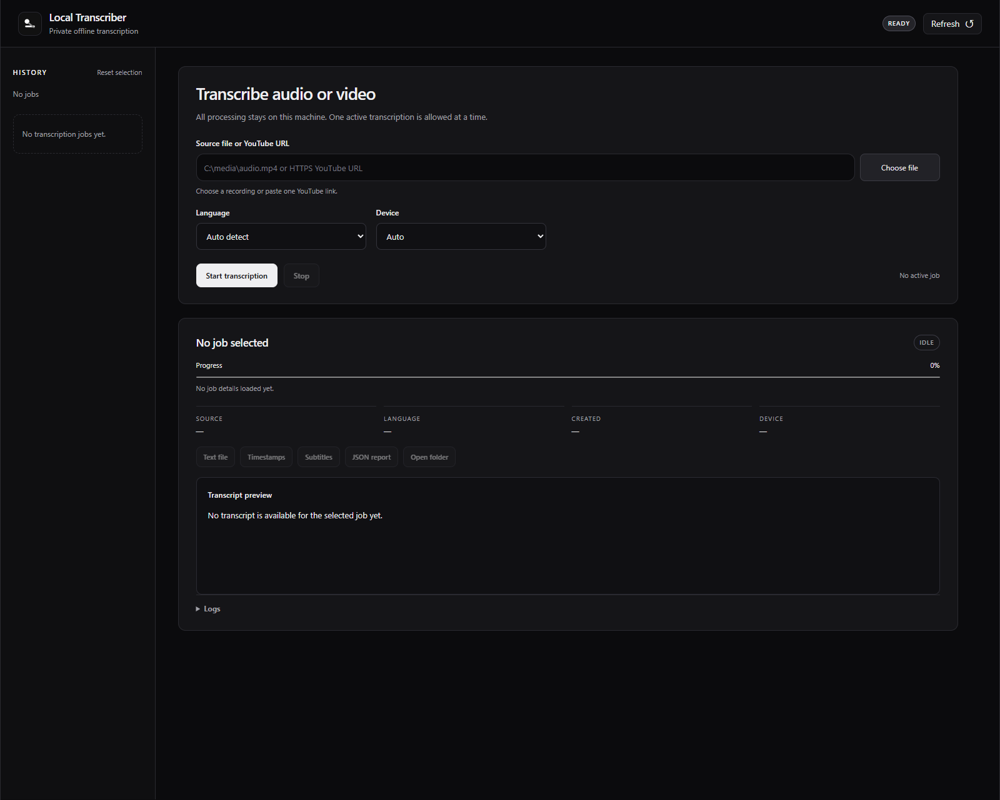

<div align="center">
  
  <h1>Local Transcriber</h1>
  <p><strong>Your recordings. Your machine. Your words.</strong></p>
  <p>A quiet, local workspace for turning long recordings into text and subtitles.</p>
  <p><a href="README.ru.md">Русский README</a> · <a href="#quick-start">Quick start</a> · <a href="#privacy--security">Privacy</a></p>
  <p><a href="https://github.com/Jericho2k/local-transcriber/actions/workflows/tests.yml"></a></p>
</div>



No transcription subscription, API key or cloud account. Speech recognition runs on your computer using **faster-whisper**. Bring a local recording or one YouTube link; get a readable transcript, timestamps, SRT subtitles and structured JSON.

## Built for long recordings

- **A local browser interface.** A monochrome workspace with job history, progress, preview, activity logs and exports.
- **Resume instead of starting over.** Each completed 10-minute block is saved atomically. Reopen the same source with the same language to reuse completed blocks.
- **GPU or CPU.** Automatic device selection, NVIDIA CUDA acceleration, and an explicit CPU mode.
- **Original-language transcription.** Automatic language detection, English/Russian UI presets, and additional language codes in the CLI. This is not a translation tool.
- **No existing subtitles required.** Recognition works from the audio itself.

## Quick start

**Windows x64 · Python 3.11 · FFmpeg**

Install [Python 3.11 x64](https://www.python.org/downloads/windows/) and [FFmpeg](https://ffmpeg.org/download.html), with both `ffmpeg` and `ffprobe` available on PATH. [Node.js](https://nodejs.org/) is optional, but some YouTube downloads require a JavaScript runtime.

```powershell
git clone https://github.com/Jericho2k/local-transcriber.git
cd local-transcriber
.\INSTALL.cmd
.\START.cmd
```

Or download the repository ZIP, extract it, then double-click **INSTALL.cmd** and **START.cmd**.

Setup installs dependencies into a private `.venv`, downloads the pinned model data (about 1.6 GB), verifies it and creates configuration for your machine. Allow roughly **8 GB free during initial GPU setup**, plus space for your recordings. It does not install Python or FFmpeg for you.

The browser opens a session on `127.0.0.1`. Choose a recording or paste one YouTube video link, choose its language and press **Start transcription**. A YouTube source is downloaded as audio; local-file recognition works without internet after setup.

### Where your files go

Each job has its own folder under `output/`:

| File | Contents |
|---|---|
| `transcript.txt` | Plain text |
| `transcript.timestamps.txt` | Text with timestamps |
| `transcript.srt` | Subtitle cues |
| `transcript.json` | Segments, timings and metadata |

Exports update after each completed block and may contain a partial transcript while a job is running or stopped. The preview shows a bounded tail; downloaded exports contain the full saved text. Stop preserves completed blocks; the unfinished block is processed again on resume. Keep `parts/` and any downloaded source audio to resume.

## Command line

```powershell
.\TRANSCRIBE.cmd "D:\media\interview.mp4" --language en
.\.venv\Scripts\python.exe -I app.py "D:\media\interview.mp4" --device cpu
.\.venv\Scripts\python.exe -I app.py --help
```

Options include `--language auto|en|ru|...`, `--device auto|cuda|cpu`, `--output`, `--chunk-seconds` and `--beam-size`. Use **CHECK.cmd** to check model loading without processing a recording.

For a CPU installation, run `INSTALL.cmd --cpu`. This skips NVIDIA dependencies and makes automatic device selection prefer CPU. Recognition is slower on CPU; runtime depends on the recording and hardware.

## Privacy & security

Audio is **not uploaded to a transcription provider**. Setup contacts PyPI and Hugging Face; a YouTube download contacts YouTube and its media hosts. Recognition itself uses the on-disk model.

- The UI binds only to loopback, uses a random session token, validates origin/host and serves local assets. No CDN, analytics or external UI scripts.
- Package versions and wheel SHA-256 hashes are pinned in `requirements.lock`. Setup requires binary wheels and hash verification; global Python packages are not modified.
- Model downloads are restricted to five data files at a pinned revision. The weights and companion data are verified; no remote model code is executed.
- TLS verification stays enabled. If needed, setup exports certificates already trusted by Windows into a local bundle; it does not add certificates to Windows or change antivirus settings.
- Media, transcripts, UI history, configuration, certificates, the environment and model files are excluded from Git. Download tools may use normal per-user caches and temporary directories.

This is a **local desktop utility**, not a server to expose to the internet. Keep normal operating-system and antivirus protection enabled. No software or scan can promise absolute safety for arbitrary future input files.

## Troubleshooting

| Issue | Next step |
|---|---|
| Setup cannot find Python | Install Python **3.11 x64** and open a new terminal. Other versions are not covered by the wheel lock. |
| FFmpeg or FFprobe missing | Add the FFmpeg `bin` directory to PATH and reopen the terminal. |
| YouTube download fails | Check Node.js and network access, or choose a local media file. Closed/private access is not bypassed. |
| CUDA or memory error | Close GPU-heavy apps, check the NVIDIA driver, or select CPU. |
| Model verification fails | Rerun setup. A complete but invalid model is re-downloaded; it is not used for recognition. |
| A job is already running | The UI runs one task at a time. Stop it or wait for completion. |

Read-only setup check: `python install.py --verify`. Automated tests: `python -m unittest discover -v`. Tests cover checkpoint recovery, export boundaries, local API access controls and installer safeguards without downloading a model or contacting a transcription service.

**Support scope:** tested on Windows x64 with Python 3.11. Other operating systems, Python versions and ARM devices are not claimed as supported. Automatic speech recognition can make mistakes, especially with names, technical terms and noisy audio.

## License & credits

[MIT](LICENSE) for this project's code. Built with [faster-whisper](https://github.com/SYSTRAN/faster-whisper), [CTranslate2](https://github.com/OpenNMT/CTranslate2), [yt-dlp](https://github.com/yt-dlp/yt-dlp) and FFmpeg. Models and dependencies retain their own licenses. Use recordings you are authorized to process.
